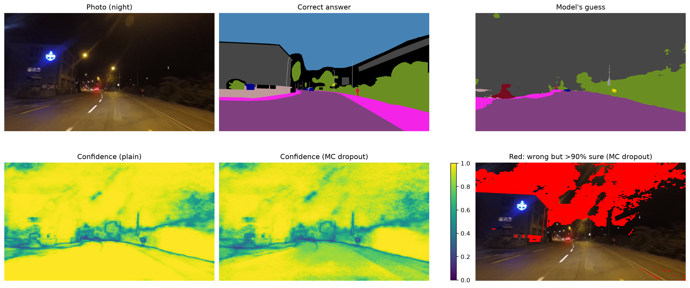
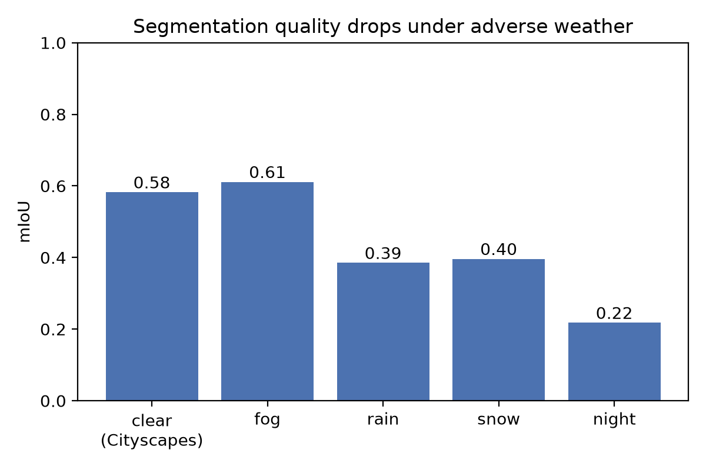
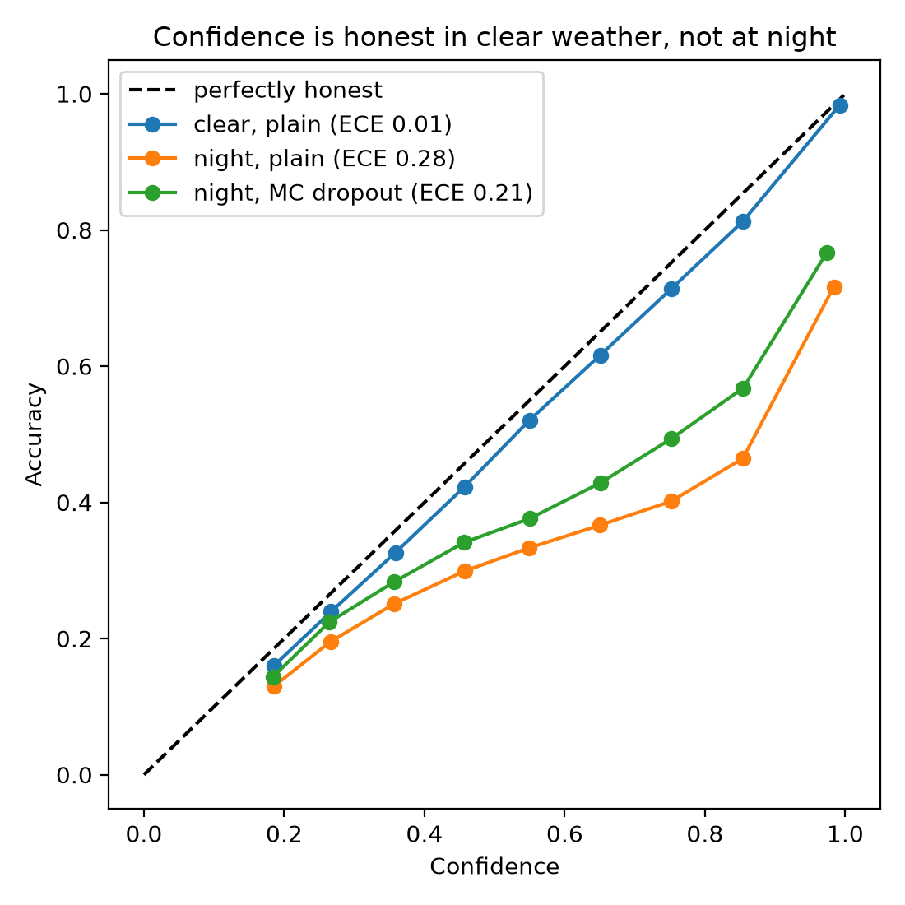
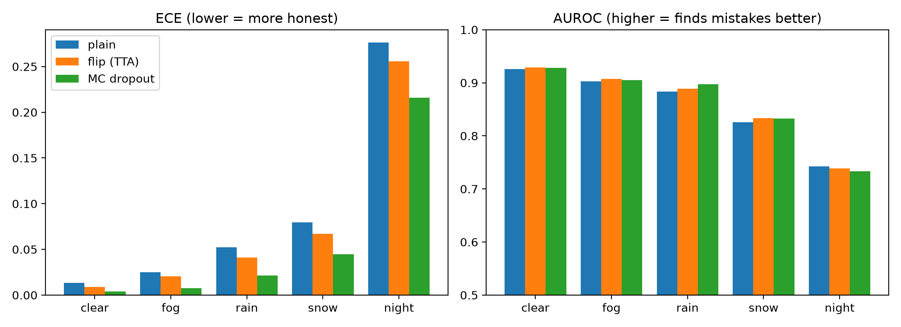

# weather-shift-segmentation

**When the weather gets bad, can a segmentation model tell us when it's wrong?**

I tested a street-scene segmentation model (SegFormer-B0, trained on clear-weather Cityscapes) on
fog, night, rain and snow, and measured whether its confidence still warns us about its mistakes.
I compared three ways of getting confidence: plain softmax, flip test-time augmentation and
Monte Carlo dropout.



*A night image from ACDC. Pixels shown in red are wrong, yet the model was more than 90% sure of
them (sky labelled as building, sidewalk labelled as road).*

## Key findings

1. **Accuracy drops a lot at night.** mIoU falls from 0.58 on clear Cityscapes to 0.22 on ACDC night.
   Rain (0.39) and snow (0.40) also drop, while fog (0.61) stays close to clear.
2. **Confidence becomes dishonest under bad weather.** Calibration error (ECE) rises from 0.014
   (clear) to 0.277 (night). How well confidence separates right from wrong pixels (AUROC) falls
   from 0.93 to 0.74.
3. **MC dropout makes confidence more honest, but it doesn't find more mistakes.** At night it
   lowers ECE from 0.277 to 0.216, but AUROC stays the same (0.74 / 0.74 / 0.73 for plain / flip /
   MC dropout). It lowers confidence on wrong *and* right pixels alike.
4. **About a quarter of night mistakes stay hidden.** Even with MC dropout, 27% of wrong night
   pixels have confidence above 0.9 (47% with plain softmax). These are mostly whole regions
   swapped between similar classes, such as sky → building and sidewalk → road. The second one
   matters for safety.

The results hold for confidence thresholds of 0.8, 0.9 and 0.95.

| Condition | mIoU | ECE (plain) | AUROC (plain) |
|-----------|------|-------------|---------------|
| clear (Cityscapes) | 0.582 | 0.014 | 0.926 |
| fog   | 0.611 | 0.025 | 0.903 |
| rain  | 0.385 | 0.052 | 0.883 |
| snow  | 0.396 | 0.080 | 0.826 |
| night | 0.218 | 0.277 | 0.742 |

| Night | ECE ↓ | AUROC ↑ | Wrong pixels with conf > 0.9 ↓ | Right pixels with conf > 0.9 |
|-------|-------|---------|--------------------------------|------------------------------|
| Plain softmax | 0.277 | 0.742 | 0.473 | 0.785 |
| Flip TTA      | 0.256 | 0.739 | 0.425 | 0.747 |
| MC dropout    | 0.216 | 0.733 | 0.273 | 0.618 |



*Segmentation quality per condition. Night loses the most.*



*Reliability diagram: a perfectly honest model lies on the dashed line. At night the model is
much more confident than it is accurate, and MC dropout only closes part of the gap.*



*Left: ECE (lower = more honest). Right: AUROC (higher = finds mistakes better). MC dropout
lowers ECE, but AUROC stays almost the same for all three methods.*

## Method

- **Model:** [`nvidia/segformer-b0-finetuned-cityscapes-1024-1024`](https://huggingface.co/nvidia/segformer-b0-finetuned-cityscapes-1024-1024), used as is, with no extra training.
- **Data:** Cityscapes validation set (clear), ACDC validation set (fog, night, rain, snow). Both use the same 19 classes.
- **Confidence:** the highest softmax probability of each pixel.
  - *Flip TTA:* average the softmax of the image and its mirrored copy.
  - *MC dropout:* switch on only the Dropout and DropPath layers (BatchNorm stays in eval mode),
    run 8 forward passes and average the softmax.
- **Metrics:**
  - mIoU for accuracy
  - ECE (10 bins) for calibration
  - AUROC of (1 − confidence) for finding wrong pixels, on 20,000 sampled pixels per image
  - the share of wrong and right pixels with confidence above 0.9

## Reproduce

```bash
uv sync
uv run pytest
```

1. Download Cityscapes and ACDC (both need free registration) and place them as described in
   [`data/README.md`](data/README.md).
2. Run the notebooks in order:

| Notebook | What it does |
|----------|--------------|
| `01_pretrained_segformer` | run the model on one image and visualise the output |
| `02_clear_vs_adverse` | mIoU per condition and per class, failure examples |
| `03_confidence_check` | reliability diagrams, ECE, AUROC, flip TTA |
| `04_main_experiment` | plain vs flip vs MC dropout, confident mistakes per class |
| `05_analysis_figures` | threshold check and the final figures |

Reusable code lives in `src/weather_shift/` (`data.py`, `model.py`, `metrics.py`). Results are
saved as CSV files in `reports/`, and the week-by-week notes are in
[`reports/weekly_log.md`](reports/weekly_log.md).

## Limitations

- The image processor resizes images to 512×512, so clear-weather mIoU (0.58) is lower than the
  published 0.76. All conditions are treated the same way, so the comparison stays fair.
- Clear and adverse images come from two different datasets (Cityscapes vs ACDC), so part of the
  drop may come from different cities and cameras, not only from the weather.
- SegFormer-B0 has little dropout (most dropout layers have p = 0), which limits what MC dropout can do.
- MC dropout results vary by about ±0.01 between runs, so I fix the seed with `torch.manual_seed(0)`.

## Next steps

- Use an independent checker, such as a vision-language model, to question regions the model is
  very sure about.
- Compare with a deep ensemble, and try fine-tuning on adverse weather.

## References

- Xie et al., *SegFormer: Simple and Efficient Design for Semantic Segmentation with Transformers*, NeurIPS 2021.
- Cordts et al., *The Cityscapes Dataset for Semantic Urban Scene Understanding*, CVPR 2016.
- Sakaridis et al., *ACDC: The Adverse Conditions Dataset with Correspondences*, ICCV 2021.
- Guo et al., *On Calibration of Modern Neural Networks*, ICML 2017.
- Hendrycks & Gimpel, *A Baseline for Detecting Misclassified and Out-of-Distribution Examples*, ICLR 2017.
- Gal & Ghahramani, *Dropout as a Bayesian Approximation*, ICML 2016.
- Wang et al., *Aleatoric Uncertainty Estimation with Test-Time Augmentation for Medical Image Segmentation*, Neurocomputing 2019.

## License

Code: MIT. The datasets keep their own licences and are not included.
